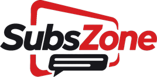

  

<h1 align="center">Hebrew subtitles for movies and series</h1>

  SubsZone is a community platform for finding, publishing, and maintaining Hebrew subtitles, matched to each video release.

  <a href="https://subszone.net"><strong>Website</strong></a>
  ·
  <a href="https://subszone.net/media-apps/"><strong>Media platform addons</strong></a>
  ·
  <a href="https://github.com/SubsZone/subszone-stremio-addon"><strong>Stremio addon</strong></a>

## Projects

### SubsZone for Stremio

Account-bound Hebrew subtitle integration for Stremio. It resolves movies and series episodes by exact IMDb identity, ranks compatible subtitle releases, and keeps installation access revocable from the SubsZone account.

• [Install and manage](https://subszone.net/stremio/)
• [Source repository](https://github.com/SubsZone/subszone-stremio-addon)
• [Public configuration manifest](https://subszone.net/stremio-addon/manifest.json)

## Principles

• Hebrew-first and RTL-friendly
• Exact title, episode, and release matching
• Publicly reviewable integration code
• Account-attributed downloads and revocable installations
• No video hosting, streams, torrents, or viewing links

## Contact and rights

For support, feedback, or rights-related requests, use the forms on the SubsZone website:

• [Contact](https://subszone.net/contact/)
• [Content rights request](https://subszone.net/contact/?subject=rights)

All names, trademarks, video works, subtitle texts, and other content remain the property of their respective owners.
